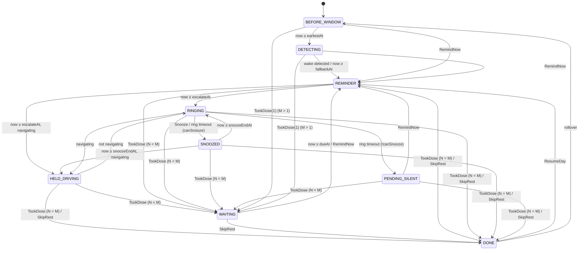

# 02 — Daily state machine

This is the heart of the app. Implement it as a **pure Kotlin reducer** in `domain/`, with no
Android imports, and cover it fully with unit tests (task T3).

## 1. Design principles

1. **There is one persisted `DayState`.** All behaviour is derived from it, together with
   `Settings` and the current time.
2. **Store base timestamps, not deadlines.** For example, we store `reminderShownAt`, not
   "escalation at". Deadlines are computed from the base timestamp plus the current settings.
   This way, changing a setting automatically reschedules everything correctly.
3. **Outputs are declarative.** A pure function `outputs(state, settings, now)` says what should be
   true right now: which notification is visible, whether the alarm is ringing, and when the next
   wake-up is. The Android layer *reconciles* the real world against this. After a reboot,
   crash or update, re-running the reconcile restores everything.
4. **Time-based transitions all happen in a single `Tick` event.** It is processed repeatedly until
   the state stops changing. Every scheduled alarm, boot, app open and settings change causes a `Tick`.

## 2. State

```kotlin
enum class Phase {
    BEFORE_WINDOW,   // day started (after rollover), waiting for earliestTime
    DETECTING,       // inside wake window, polling usage log
    WAITING,         // dose N-1 taken, waiting doseInterval before dose N reminder
    REMINDER,        // dose N reminder notification visible, escalation timer running
    RINGING,         // dose N alarm ringing
    SNOOZED,         // dose N alarm snoozed
    HELD_DRIVING,    // dose N alarm due, held while Google Maps navigates (01 FR-3.8)
    PENDING_SILENT,  // dose N: snoozes exhausted, ongoing notification only, no more alarms
    DONE             // all doses taken, or rest of day skipped
}

enum class DoseStatus { TAKEN, SKIPPED, MISSED }
enum class DoseSource { NOTIFICATION, ALARM, APP_NOW, APP_BACKDATED }
enum class WakeSource { DETECTED, FALLBACK, MANUAL }

data class DoseRecord(
    val index: Int,                 // 1-based
    val status: DoseStatus,
    val takenAt: Instant?,          // only for TAKEN
    val source: DoseSource?,        // only for TAKEN
    val snoozesUsed: Int,
    val firstRemindedAt: Instant?,  // when the reminder for this dose first appeared
)

data class DayState(
    val dayId: LocalDate,           // calendar date on which this app-day started
    val phase: Phase,
    val nextDose: Int,              // dose that is next/pending (1..dosesPerDay); irrelevant in DONE
    val doses: List<DoseRecord>,    // finalised doses, ordered by index
    val wakeAt: Instant?,
    val wakeSource: WakeSource?,
    // Base timestamps for the current dose (reset when a new dose becomes current):
    val reminderShownAt: Instant?,  // set when entering REMINDER
    val firstRemindedAt: Instant?,  // first time REMINDER was entered for nextDose
    val ringingSince: Instant?,     // set when entering RINGING
    val snoozedAt: Instant?,        // set when entering SNOOZED
    val snoozesUsed: Int,
)
```

**Derived values.** Here `S` is the settings object and `tz` is the system default zone at
evaluation time.

| Name | Definition |
|------|------------|
| `dayIdOf(now)` | `(now in tz − S.dayRolloverTime).toLocalDate()`. 02:59 on 13 Oct belongs to day 12 Oct. |
| `isWeekend(day)` | `day.dayOfWeek in {SATURDAY, SUNDAY}` |
| `earliestAt(day)` | `day` at `weekendEarliestTime` or `weekdayEarliestTime`, in `tz` |
| `fallbackAt(day)` | Same pattern, using the fallback times |
| `nextRolloverAt(day)` | `(day + 1)` at `dayRolloverTime`, in `tz` |
| `lastTakenAt` | `takenAt` of the dose `nextDose − 1` (null for dose 1) |
| `dueAt` | `lastTakenAt + S.doseInterval` (WAITING only) |
| `escalateAt` | `reminderShownAt + S.escalationDelay`; for `nextDose == 1`, `S.holdFirstAlarmUntilFallback`, `wakeSource == DETECTED` and `reminderShownAt == wakeAt` (the reminder came from wake detection), `max(that, fallbackAt(dayId))` (FR-3.1a, A57) |
| `ringEndAt` | `ringingSince + S.alarmRingDuration` |
| `snoozeEndAt` | `snoozedAt + S.snoozeDuration` |
| `canSnooze` | `snoozesUsed < S.maxSnoozes` |

A **fresh day** `fresh(day)` is `DayState(dayId = day, phase = BEFORE_WINDOW, nextDose = 1,
doses = [], everything else null/0)`.

## 3. Diagram



Rollover (`dayIdOf(now) != state.dayId`) can happen from **any** phase. It is omitted from the
diagram for every phase except DONE.

## 4. Events and transitions

```kotlin
sealed interface Event {
    data class Tick(val wakeDetected: Boolean, val navigating: Boolean = false) : Event   // wakeDetected only meaningful in DETECTING
    data class TookDose(val dose: Int, val at: Instant, val source: DoseSource) : Event
    data class SkipRest(val dose: Int) : Event
    data class Snooze(val dose: Int) : Event
    data object RemindNow : Event
    data object ResumeDay : Event
}

data class Transition(val state: DayState, val finishedDay: DayState?)  // finishedDay set on rollover

fun reduce(state: DayState, event: Event, s: Settings, now: Instant, zone: ZoneId): Transition
```

**The orchestrator fills `navigating` from the `NavigationDetector` on every Tick** (a cheap
in-memory check, 01 FR-3.8). User events ignore it.

**The orchestrator gets `wakeDetected` from the `WakeDetector`.** It calls the detector only when
the persisted phase is `DETECTING`. A `BEFORE_WINDOW → DETECTING` change happens inside the same
Tick, so the orchestrator must handle it too. If the post-tick phase is `DETECTING` and detection
was not run, it runs detection and ticks once more. The engine itself never does I/O.

### 4.1 Always first: rollover check (for every event)
| Condition | Result |
|-----------|--------|
| `dayIdOf(now) != state.dayId` | Finalise the old day: if phase ≠ DONE, every dose from `nextDose..M` not yet in `doses` is recorded as `MISSED`. The current dose's record carries `snoozesUsed` and `firstRemindedAt`. The finalised day becomes DONE with its per-dose fields cleared (A10). Return `finishedDay = finalised old state`. Continue processing the event against `fresh(dayIdOf(now))`. User events that target a dose (TookDose/SkipRest/Snooze) are ignored after a rollover, because they were stale. Tick proceeds normally. |

### 4.2 Tick (repeat until the phase stops changing, max 10 iterations)
| Phase | Condition | New phase | Side changes |
|-------|-----------|-----------|--------------|
| BEFORE_WINDOW | `now ≥ earliestAt(dayId)` | DETECTING | none |
| DETECTING | `wakeDetected` | REMINDER | `wakeAt = now`, `wakeSource = DETECTED`, `reminderShownAt = now`, `firstRemindedAt = now` |
| DETECTING | `now ≥ fallbackAt(dayId)` | REMINDER | Same, but `wakeSource = FALLBACK` |
| WAITING | `now ≥ dueAt` | REMINDER | `reminderShownAt = now`, `firstRemindedAt = now` |
| REMINDER | `now ≥ escalateAt` and `navigating` | HELD_DRIVING | none |
| REMINDER | `now ≥ escalateAt` | RINGING | `ringingSince = now` |
| RINGING | `navigating` (checked first) | HELD_DRIVING | `ringingSince = null`; no snooze used |
| RINGING | `now ≥ ringEndAt` and `canSnooze` | SNOOZED | `snoozedAt = now`, `snoozesUsed += 1` |
| RINGING | `now ≥ ringEndAt` and `!canSnooze` | PENDING_SILENT | `ringingSince = null` |
| SNOOZED | `now ≥ snoozeEndAt` and `navigating` | HELD_DRIVING | none |
| SNOOZED | `now ≥ snoozeEndAt` | RINGING | `ringingSince = now` |
| HELD_DRIVING | `navigating` | unchanged | — |
| HELD_DRIVING | not `navigating` | RINGING | `ringingSince = now` |
| PENDING_SILENT, DONE | — | unchanged | — |

`wakeDetected` only counts if the phase was already DETECTING when the event arrived; it is
ignored in the Tick that moves BEFORE_WINDOW → DETECTING (A10).

**Corrupt states (A10):** if the base timestamp of REMINDER, RINGING or SNOOZED is null, the
Tick sets it to `now` and stays in that phase. WAITING with no `lastTakenAt` goes to REMINDER.

Note: when a deadline was missed by a long time (phone off), we do **not** replay the missed
steps. The engine enters the next phase with `now` as the new base timestamp. For example, if
the phone boots 3 h after a reminder was shown, it goes straight to RINGING; the 3 h of
snoozes are not simulated.

### 4.3 User events
A user event is **valid** only if the conditions below hold. Invalid events are ignored and the
state is returned unchanged. This makes stale notification buttons harmless. Every notification
or alarm PendingIntent carries `dayId` and `dose`, and the orchestrator drops intents whose
`dayId` ≠ the state's `dayId`.

| Event | Valid when | Result |
|-------|-----------|--------|
| `TookDose(n, at, src)` | `phase ≠ DONE`, `n == nextDose`, `at ≤ now`, `at ≥ (lastTakenAt ?: startOfDay)` | Append `DoseRecord(n, TAKEN, at, src, snoozesUsed, firstRemindedAt)`. If `n == 1` and `wakeAt == null`: `wakeAt = at`, `wakeSource = MANUAL`. If `n == M` → DONE. Else → WAITING with `nextDose = n+1`. Clear the per-dose fields (`reminderShownAt`, `firstRemindedAt`, `ringingSince`, `snoozedAt`, `snoozesUsed = 0`). **Then run Tick**: a backdated dose may already be due. |
| `SkipRest(n)` | `phase ≠ DONE`, `n == nextDose` | For each dose `n..M`, append `SKIPPED`. The record for `n` carries `snoozesUsed` and `firstRemindedAt`. → DONE, with the per-dose fields cleared. |
| `Snooze(n)` | `phase == RINGING`, `n == nextDose`, `canSnooze` | → SNOOZED, `snoozedAt = now`, `snoozesUsed += 1`, `ringingSince = null` |
| `RemindNow` | `phase ∈ {BEFORE_WINDOW, DETECTING, WAITING, PENDING_SILENT}` | → REMINDER, `reminderShownAt = now`, `firstRemindedAt ?: now`. If `nextDose == 1` and `wakeAt == null`: `wakeAt = now`, `wakeSource = MANUAL`. Snooze count is kept. |
| `ResumeDay` | `phase == DONE` and `doses` contains at least one `SKIPPED` | Remove all `SKIPPED` records, set `nextDose` to the lowest removed index, then → REMINDER with fresh per-dose fields, `reminderShownAt = now` and `firstRemindedAt = now`. If the new `nextDose == 1` and `wakeAt == null`: `wakeAt = now`, `wakeSource = MANUAL` (A8). |

Here `M` = `S.dosesPerDay`, read at evaluation time. If `dosesPerDay` is lowered below
`nextDose` during a day, the next Tick treats the day as complete: the phase becomes DONE, and
no doses are recorded as missed or skipped, and the per-dose fields are cleared. Add this as a
Tick rule that applies to any phase other than DONE.

`startOfDay` = `dayId` at `dayRolloverTime`.

## 5. Outputs (declarative)

```kotlin
data class Outputs(
    val reminder: ReminderSpec?,   // ongoing notification to show, or null = cancel
    val ringing: RingSpec?,        // alarm must be ringing, or null = must be stopped
    val nextWakeAt: Instant,       // exact alarm to schedule
    val status: StatusSpec? = null, // FR-2.4 status notification, only with S.showStatusNotification
)
data class ReminderSpec(val dayId: LocalDate, val dose: Int, val doseCount: Int, val alarmStyle: Boolean, val canSnooze: Boolean, val snoozesLeft: Int, val subtitle: ReminderSubtitle?,
                        val lowStock: LowStock? = null,   // always null from outputs(); the orchestrator fills it (01 FR-10.3)
                        val pharmacyPhone: String? = null) // likewise, from S.pharmacyPhone (01 FR-10.6)
data class LowStock(val pillsLeft: Int, val daysLeft: Int)
sealed interface ReminderSubtitle {                 // worded by :app from strings.xml (A9)
    data class Snoozed(val until: Instant) : ReminderSubtitle   // "Snoozed until HH:MM", device zone
    data object AlarmStopped : ReminderSubtitle                  // "Alarm stopped — please take your pill"
    data object HeldWhileDriving : ReminderSubtitle              // "Alarm held while you drive"
}
data class RingSpec(val dayId: LocalDate, val dose: Int, val doseCount: Int, val canSnooze: Boolean, val snoozesLeft: Int)
sealed interface StatusSpec {                       // worded by :app
    data class NextDose(val dose: Int, val doseCount: Int, val dueAt: Instant) : StatusSpec  // WAITING, counts down to dueAt
    data class WaitingForWake(val doseCount: Int, val fallbackAt: Instant) : StatusSpec      // BEFORE_WINDOW, DETECTING
    data class CallPharmacy(val lowStock: LowStock, val pharmacyPhone: String?) : StatusSpec // DONE, low supply; set by the orchestrator (01 FR-10.6)
}

fun outputs(state: DayState, s: Settings, now: Instant, zone: ZoneId): Outputs
```

| Phase | `reminder` | `ringing` | `nextWakeAt` (always `min(x, nextRolloverAt(dayId))`) |
|-------|------------|-----------|------|
| BEFORE_WINDOW | null | null | `earliestAt(dayId)` |
| DETECTING | null | null | `min(now + S.detectionPollInterval, fallbackAt(dayId))` |
| WAITING | null | null | `dueAt` |
| REMINDER | normal style | null | `escalateAt` |
| RINGING | alarm style (with Snooze if `canSnooze`) | RingSpec | `ringEndAt` |
| SNOOZED | normal style, subtitle `Snoozed(snoozeEndAt)` ("Snoozed until HH:MM") | null | `snoozeEndAt` |
| HELD_DRIVING | normal style, subtitle `HeldWhileDriving` ("Alarm held while you drive") | null | `now + 5 min` (`Engine.NAVIGATION_RECHECK_INTERVAL`, a backup re-check) |
| PENDING_SILENT | normal style, subtitle `AlarmStopped` ("Alarm stopped — please take your pill") | null | `nextRolloverAt` |
| DONE | null | null | `nextRolloverAt` |

`status` is null unless `S.showStatusNotification` is on. Then it is `WaitingForWake(fallbackAt)` in
BEFORE_WINDOW and DETECTING, `NextDose(nextDose, dueAt)` in WAITING (null if `dueAt` is missing),
and null in DONE and in every phase that shows a reminder. It never changes `nextWakeAt`.

If `nextWakeAt ≤ now` (an overdue deadline that the Tick loop didn't resolve, which shouldn't
happen), schedule it for `now + 1 s`.

## 6. Orchestration (Android side, described here for completeness)

```
handle(event, expectedDayId = null):
    mutex.withLock {
        if (expectedDayId != null && expectedDayId != dayIdOf(now)) return   // stale action (01 A15)
        state = stateStore.load() ?: fresh(dayIdOf(now))
        detectNow = event is Tick && state.phase == DETECTING && state.dayId == dayIdOf(now)   // 01 A13
        detected = if (detectNow) wakeDetector.isAwake(...) else false
        t = reduce(state, event-with-detected, settings, now)
        if (t.state.phase == DETECTING && event is Tick && !detectNow):
            t = reduce(t.state, Tick(wakeDetector.isAwake(...)), settings, now)   // see §4 note
        t.finishedDay?.let { history.upsert(it) }
        stateStore.save(t.state)
        history.upsert(t.state)            // keep today's history row live
        pillStock.take(PillStock.pillsTaken(state, t.state))   // 01 FR-10.2
        lowStock = PillStock.lowStock(pillStock.current(), settings.dosesPerDay)
        o = outputs(t.state, settings, now)
        o.reminder.lowStock = lowStock; o.reminder.pharmacyPhone = settings.pharmacyPhone
        if (o.status == null && settings.showStatusNotification && t.state.phase == DONE
                && lowStock != null)
            o.status = CallPharmacy(lowStock, settings.pharmacyPhone)              // 01 FR-10.6
        apply(o)   // notifications, ring service, AlarmManager
    }
```

`apply` must be **idempotent**. Re-posting the same notification ID is fine. Starting the ring
service when it is already ringing for the same dose is a no-op. Stopping the service when it
isn't running is a no-op.

## 7. Worked example (defaults, weekday)

| Time | What happens | Phase after |
|------|--------------|-------------|
| 03:00 | Rollover tick. Yesterday is finalised. | BEFORE_WINDOW, wake-up at 07:00 |
| 07:00 | Tick; polls every 5 min | DETECTING |
| 07:25 | Poll: 2 unlocks since 07:10. Dose 1 reminder shown. | REMINDER |
| 10:30 | Not acted on; the dose 1 alarm waited for the fallback time and rings now | RINGING |
| 10:32 | Ring timeout; snooze 1/3 | SNOOZED |
| 10:42 | Rings again; I tap "I took my pill" | WAITING (dose 2 due 14:32) |
| 14:32 | Dose 2 reminder (alarm at 14:47 if ignored) | REMINDER |
| 14:40 | I tap "I took my pill" | WAITING (dose 3 due 18:30) |
| 18:30 | Dose 3 reminder; I tap "I took my pill" at 18:31 | DONE, wake-up at 03:00 |
